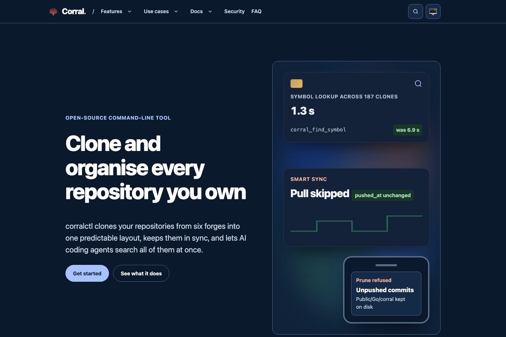

<!-- SPDX-License-Identifier: Apache-2.0 OR MIT -->
<!--
README template. Global rules: see ~/Code/AGENTS.md and ~/Code/REPO-STANDARD.md.
Releases adhere strictly to https://github.com/sebastienrousseau/passmcp/releases/tag/v0.0.5
-->

<p align="center">
  
</p>

<h1 align="center">corrallib.com</h1>

<p align="center">
  The website for Corral and its corralctl command-line tool, built with Static Site Generator and the Prism theme.
</p>

<p align="center">
  <a href="https://github.com/sebastienrousseau/corrallib.github.io/actions"></a>
  <a href="https://corrallib.com/"></a>
  <a href="https://scorecard.dev/viewer/?uri=github.com/sebastienrousseau/corrallib.github.io"></a>
  <a href="LICENSE-MIT"></a>
</p>

<p align="center">
  
</p>

---

## Contents

**Getting started**

- [Install](#install) — what to install to build the site
- [Requirements](#requirements) — ssg, Python, Chrome for the screenshot
- [Quick Start](#quick-start) — build, check and preview locally

**The corrallib.com ecosystem**

- [The corrallib.com ecosystem](#the-corrallibcom-ecosystem) — the site, the tool it describes, the theme and the generator

**Library reference**

- [Capabilities at a glance](#capabilities-at-a-glance) — what the build produces and checks
- [Ecosystem comparison](#ecosystem-comparison) — not applicable to a website
- [Benchmarks](#benchmarks) — not applicable to a website
- [Features](#features) — pages and structure
- [Configuration](#configuration) — `ssg.toml` and the content schema
- [Examples](#examples) — not applicable to a website

**Operational**

- [When not to use corrallib.com](#when-not-to-use-corrallibcom) — where the reference lives instead
- [Development](#development) — make targets and CI
- [Security](#security) — CSP, SRI and supply chain
- [Documentation](#documentation) — where each part is described
- [Stability guarantees](#stability-guarantees) — URLs and build output
- [License](#license)

---

## Install

### As a website project

```bash
git clone https://github.com/sebastienrousseau/corrallib.github.io.git
cd corrallib.github.io
```

Install `ssg` 0.0.69 or newer from its
[releases](https://github.com/sebastienrousseau/static-site-generator/releases)
or with `cargo install ssg`.

---

## Requirements

- **ssg** 0.0.69 or newer on `PATH` (CI pins the 0.0.69 release by SHA-256).
- **Python** 3.11 or newer, for the post-build scripts.
- **Chrome or Chromium**, only for `make screenshot`.

---

## Quick Start

```bash
make build   # build into docs/ and run every check
make serve   # build, then serve on http://127.0.0.1:8000
```

`make build` fails if any check fails, so a passing build is a deployable one.

---

## The corrallib.com ecosystem

corrallib.com describes [corralctl](https://github.com/sebastienrousseau/corralctl),
a Go command-line tool and MCP server, and is generated by
[Static Site Generator](https://github.com/sebastienrousseau/static-site-generator).

| Component | Purpose | Use case |
| :--- | :--- | :--- |
| corrallib.github.io | This repository: content, layouts and build scripts | Changing the website |
| corralctl | The tool the site documents; its README is the source of every fact here | Using Corral |
| Prism theme | The design, from ssg-themes.github.io (MIT, see `LICENSES/`) | Restyling the site |
| Static Site Generator | Builds and audits the site | Building locally and in CI |

---

## Capabilities at a glance

| Area | Capability | Status |
| :--- | :--- | :--- |
| Build | ssg compiles `_posts/` with `_layouts/` into `docs/` | Stable |
| Checks | ssg quality gate, heading anchors, cross-page `#fragment` links, SRI hashes, `ssg audit` | Enforced in CI |
| Deploy | GitHub Actions to GitHub Pages; nothing built is committed | Stable |
| Search | ssg's search widget in the header slot | Stable |
| Structured data | WebSite, SoftwareApplication, Person, WebPage, FAQPage | Stable |

---

## Ecosystem comparison

Not applicable: this repository is a website, not a library.

---

## Benchmarks

Not applicable: this repository is a website. corralctl's published figures
are on the site's [performance page](https://corrallib.com/benchmarks/).

---

## Features

- Twenty pages: home, features, use cases, MCP server, getting started,
  command reference, examples, how it works, performance, security, FAQ,
  about, changelog, contributing, contact, accessibility, privacy, terms,
  colophon and 404.
- A shared header and footer in `_layouts/`, written once for the site.
- Every fact about corralctl is taken from its README, CHANGELOG and
  CONTRIBUTING; nothing is illustrative.

---

## Configuration

- `ssg.toml`: site name, description, `base_url` and the content, template
  and output directories.
- `_posts/content.schema.toml`: the front-matter fields every page must
  carry; ssg fails the build when one is missing.

---

## Examples

Not applicable: this repository is a website. corralctl's examples are on the
site's [examples page](https://corrallib.com/examples/).

---

## When not to use corrallib.com

The site summarises corralctl for people deciding whether to use it. The
reference is the corralctl repository's README and the user manual at
<https://doc.corrallib.com/>; when they disagree with this site, they win.

---

## Development

```bash
make build       # ssg build, anchors, post-build checks, ssg audit
make serve       # build and serve locally
make screenshot  # render static/images/screenshot.png from the build
make clean       # remove build output
```

`.github/workflows/quality-gate.yml` runs `make build` on every pull request.
`.github/workflows/pages.yml` runs it on `main` and deploys `docs/` to
GitHub Pages.

---

## Security

Every page carries a strict Content Security Policy: scripts, styles and
images from this origin only, and form submissions to this origin and
Formspree. Every local script and stylesheet carries a Subresource Integrity
hash, which the build verifies against the file. CI installs ssg from its
release and checks the archive against a pinned SHA-256.

Report vulnerabilities according to [`SECURITY.md`](SECURITY.md).

---

## Documentation

- The website: <https://corrallib.com/>
- corralctl: <https://github.com/sebastienrousseau/corralctl>
- The user manual: <https://doc.corrallib.com/>
- Static Site Generator: <https://github.com/sebastienrousseau/static-site-generator>
- Third-party licences: [`LICENSES/`](LICENSES/)

---

## Stability guarantees

Page URLs are kept across redesigns, so links to the site keep working. The
exceptions are `/api/`, `/offline/` and `/thanks/`, removed in 0.0.3: the
first described a Rust crate that does not exist, and the other two belonged
to the previous design. The sitemap is dated by the last commit, and CI pins
the ssg release it builds with.

---

## License

The site's source is available under [Apache-2.0](LICENSE-APACHE) or
[MIT](LICENSE-MIT), at your option. The Prism theme files in `_layouts/` are
MIT-licensed; see [`LICENSES/`](LICENSES/). corralctl itself is GPL-3.0.
